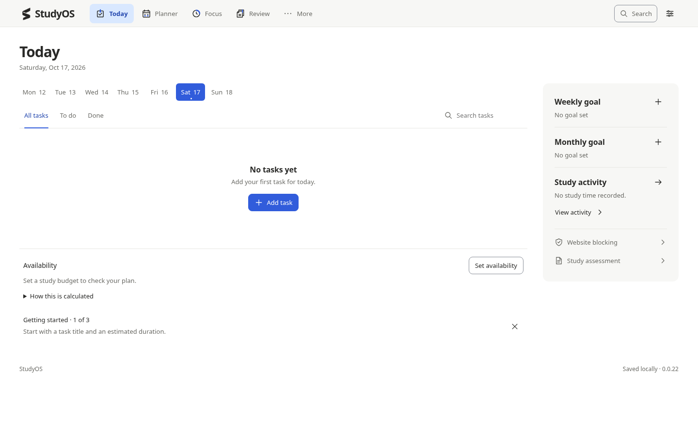
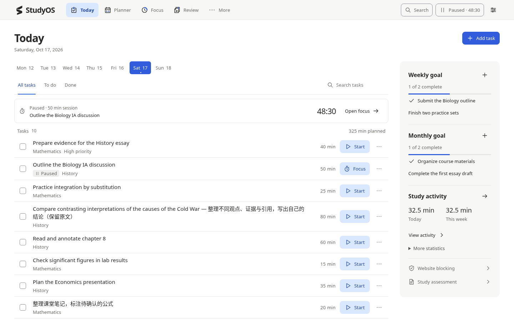
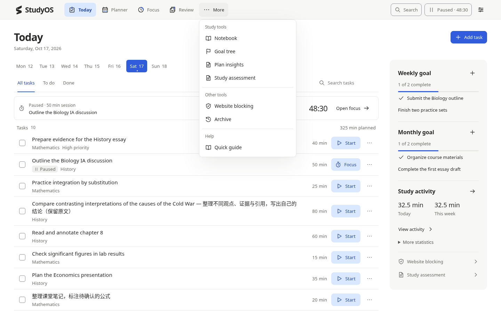
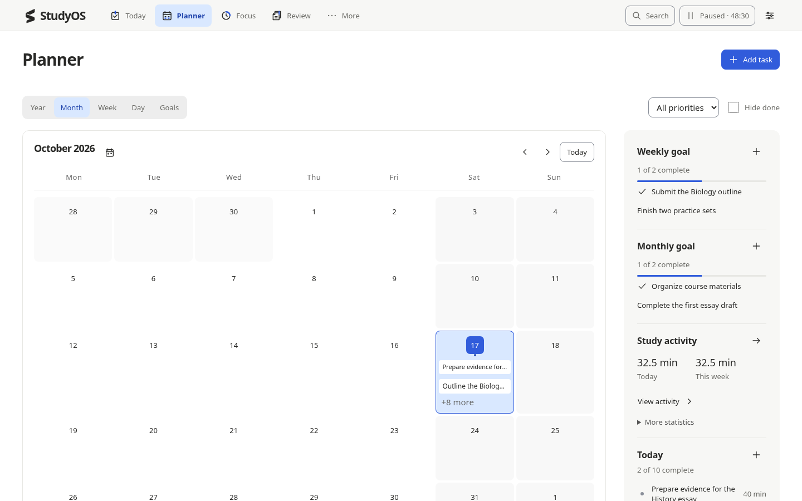
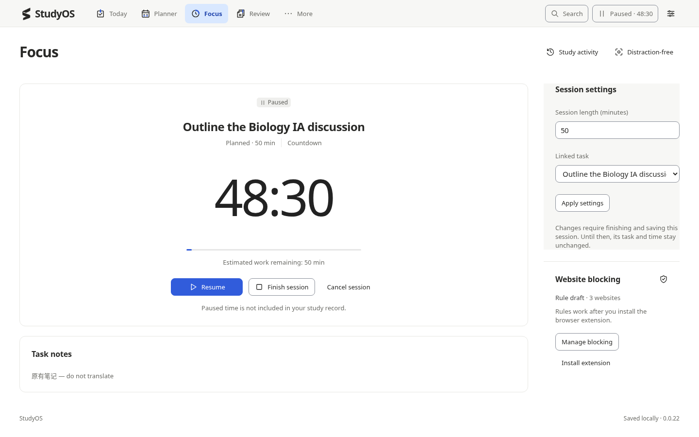
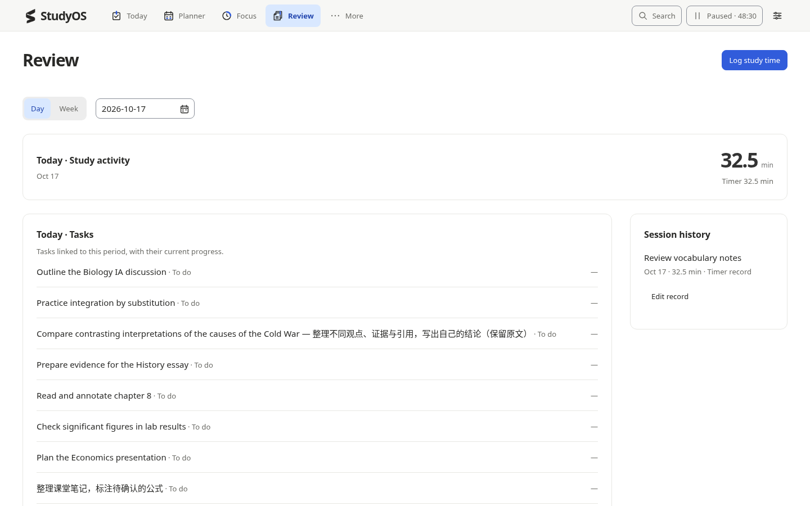

# StudyOS 0.0.22

[**下载可打开的单文件版（ZIP）**](./StudyOS_0.0.22_HTML_only.zip?raw=true) · [HTML 文件页面](./StudyOS_0.0.22.html) · [完整验收表](./VERIFICATION.md)

下载 ZIP 后解压，双击 `StudyOS_0.0.22.html`，用 Chrome 或 Edge 打开。只想下载 HTML 时，进入文件页面，点击 Download raw file（向下箭头）。

This download contains the complete standalone HTML. No installation or extra resources are required.

## 本轮改动

- 精简顶部入口，More 改为紧凑下拉菜单。
- 任务与计时状态区分运行、暂停和待保存。
- Today 与 Planner 共用目标和活动侧栏。
- 减少重复的新建、Availability、引导和 Review 说明。
- 整理旧样式；沿用原有计时、存储、备份和恢复逻辑。

22 组实际检查通过，覆盖三个桌面尺寸。截图全部来自实际运行，使用隔离测试数据，发布 HTML 不包含这些测试存档。详细通过项和未验证项见验收表。

更新前保留旧文件并导出备份。浏览器可能将不同文件路径的数据分别保存；新文件中未显示旧记录时，请使用 Settings 中的 Restore backup。

## 实际运行截图 · 1440×900

### Today — empty

### Today — ten tasks

### More

### Planner

### Focus — paused

### Review

## 源码与原版

[0.0.22 源码、构建脚本与测试](https://github.com/notenking/Test-by-notenking/tree/design/studyos-0.0.22) · [保留的 0.0.21](https://github.com/notenking/Test-by-notenking/tree/downloads/studyos-0.0.21)

主分支没有改动。本分支只用于交付下载与核对。

HTML SHA-256: `1a9a4c2b44b97c1bdb48e9f8fffa6969fa54503fff1180bfba2144fef92434b0`
